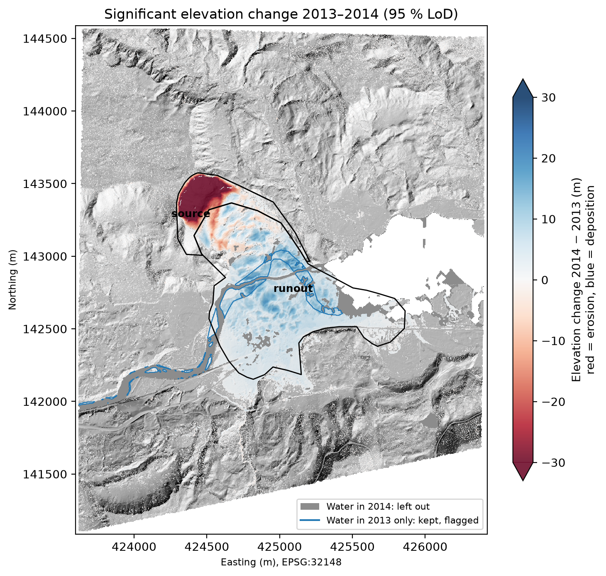
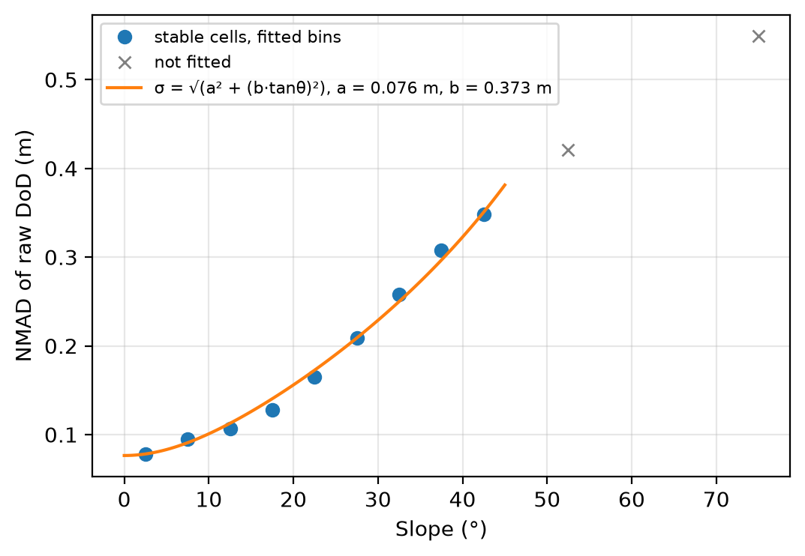
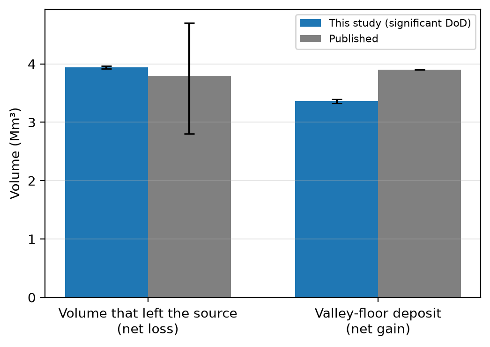

# Oso (SR530) landslide: lidar change detection and sediment budget

[](https://github.com/ThomasGBernard/oso-landslide-lidar-change/actions/workflows/ci.yml)
[](LICENSE)
[](LICENSE-docs.md)

How much material left the source of the 2014 Oso landslide, and how much stayed on the valley floor? This repository
answers with repeat airborne lidar (2013 against spring 2014), a DEM of difference thresholded by a spatially
varying Level of Detection, and a budget whose uncertainty is stated term by term. The volume that left the source
matches the published estimate. The valley-floor deposit comes out 14 % below it, because in April 2014 part of the
deposit was still under water (the impoundment lake and the new river channel): those cells are left out, and the
water is mapped from the lidar itself. The terrain models use 3 m cells, chosen from the ground point density: at
1 m most of the source volume would rest on interpolation.



## The event

On 22 March 2014 a slope of glacial deposits about 180–190 m high failed above the North Fork Stillaguamish River,
near Oso, Washington. The debris crossed the valley, buried the Steelhead Haven neighbourhood and State Route 530,
dammed the river, and killed 43 people (Iverson et al., 2015). It is one of the deadliest landslides in U.S. history,
and it has been studied in detail by the U.S. Geological Survey (Haugerud, 2014; Iverson et al., 2015; Anderson et
al., 2017).

## Data

| | Pre-event (t0) | Post-event (t1) |
|---|---|---|
| Survey | Puget Sound LiDAR Consortium, 2013 Tulalip Partnership | Washington State DOT, 2014 Stillaguamish lidar including Oso |
| Vendor | Watershed Sciences Inc. | Quantum Spatial |
| Dates | 17 April – 31 July 2013 | flights 24 March – 9 April 2014; this area 3 and 6 April (86 % of points) and a Monday (14 %) |
| Ground points used | 10.8 M (1.2 pts/m² under the forest) | 15.7 M |

Neither survey is redistributed here; `data/README.md` says where to download them (free account) and under which
terms.

## The trap in the data: metres that are feet

Both deliveries say EPSG:32148 (NAD83 / Washington North, **metres**) in their GeoKeys. The coordinates are in **US
survey feet**: the vendor report says so, and the Z range of 235–1,070 only fits the valley floor at Oso (72 m) in
feet. Read as labelled, every vertical change would be 3.28 times too large and every volume 35.3 times too large,
and a CRS check on the EPSG code would pass. The workflow overrides the label with the true feet-based CRS and
converts to metres on the same datum before anything else (`src/oso_cd/prepare.py`).

The 2013 survey is on NAD83(HARN) and the 2014 survey on NAD83(2011). The difference is centimetric at Oso and is
absorbed by the registration on stable terrain (next section).

## Method

1. **Units and ground.** PDAL pipeline: CRS override (ftUS), reprojection to metres, ASPRS class 2 only.
2. **Registration.** py4dgeo stable-area ICP (Yang and Schwieger, 2022; Besl and McKay, 1992; Anders et al., 2026)
   on the ground points, thinned to one point per 1 m voxel, in a local frame. Residual offset found: a few
   centimetres (−0.04, −0.05, −0.09 m).
3. **DTMs.** 3 m inverse-distance gridding of the ground points within res/√2 of each cell centre (as PDAL
   `writers.gdal`), then a GDAL inverse-distance fill of the gaps inside the common footprint. Every cell is
   recorded as measured or interpolated, with its distance to the nearest measured cell. 95.0 % (2013) and 95.5 %
   (2014) of the cells are measured; at 1 m, 36 % of the 2013 cells had no ground point under the forest (next
   section, "Why 3 m cells").
4. **Error model** from 8 hand-drawn stable areas (about 0.66 km², 66,500 cells of 3 m), where the true change is zero (after
   Hugonnet et al., 2022, with robust NMAD statistics after Höhle and Höhle, 2009):
   - slope term σ_DoD(θ) = √(a² + (b·tanθ)²) fitted on measured cells: a = 0.076 m, b = 0.373 m;
   - interpolation term as a function of the distance to the nearest measured cell (at 3 m only 5,979 stable
     cells are interpolated, too few for distance bins: one constant, 0.18 m, is used);
   - systematic error σ_sys = 0.021 m, the spread of the per-area medians;
   - cells steeper than 45° get no σ and never count as change.
5. **Water.** A ground DTM has no ground under water: the gap-filled DTM bridges the lake and the river from their
   banks, and the DoD would count the water level as deposit. The 2014 delivery classifies water (ASPRS class 9,
   667,000 points), but where the lake returns are too sparse to be bridged its mask misses water: the class 9 mask
   (gaps between sparse returns closed, 1 m buffer for the shore) was polygonised and the missed water drawn by
   hand (`inputs/water_2014.gpkg`). The 2013 delivery has no water class, so its river channel was drawn (`inputs/water_2013.gpkg`).
   Cells where 2014 is water leave the budget and are reported apart; cells that were water in 2013 only (the old
   channel, now under the deposit) stay in the budget and are flagged (`src/oso_cd/water.py`).
6. **DoD and Level of Detection.** ΔZ = Z₂₀₁₄ − Z₂₀₁₃ is significant where |ΔZ| > 1.96·√(σ₀² + σ₁²), the 95 %
   threshold of Brasington et al. (2003), Lane et al. (2003) and Wheaton et al. (2010). Median LoD: 0.22 m.
7. **Budget by zone.** Source zone (behind the USGS headscarp) and runout zone (USGS approximate deposit extent,
   Haugerud, 2014), each split into measured and interpolated cells, with the water parts listed apart.



On the stable areas the DoD has an NMAD of 0.102 m on measured cells and a median offset of −0.028 m, in line with
the 0.05–0.13 m that Anderson et al. (2017) report for the same surveys.

## Results

| Zone | Area (km²) | Erosion (Mm³) | Deposition (Mm³) | Net (Mm³) | Stated uncertainty (Mm³) |
|---|---|---|---|---|---|
| Source | 0.175 | 3.98 | 0.04 | **−3.94** | ± 0.02 |
| Runout | 0.900 | 0.34 | 3.70 | **+3.36** | ± 0.03 |

- **Water in the runout.** In 0.08 km² of the runout, the 2014 surface is water (the new river channel and ponds on
  the deposit). Those cells are left out: counted to the water surface they would add 0.27 Mm³, so the runout gain is
  between 3.36 Mm³ (dry ground only) and 3.64 Mm³ (water surface taken as ground). In 0.08 km² the deposit buried the
  2013 river: those cells stay in the budget (0.67 Mm³ of deposition) but are underestimated by the 2013 water depth.
- **Mass balance.** Over source and runout together, erosion is 4.32 Mm³ and deposition 3.74 Mm³ (net −13 % of the
  erosion). 0.27 Mm³ of the 0.58 Mm³ gap is the deposit under the 2014 water; the rest is within bulking and
  uncertainty.
- **Uncertainty.** Stated as the systematic term (σ_sys × zone area: ± 0.004 and ± 0.018 Mm³) plus a conservative
  interpolation term (a 1 m bias of one sign on every interpolated cell of change: ± 0.018 and ± 0.016 Mm³). With
  3 m cells, 18 % of the source volume and 2 % of the runout volume come from cells interpolated in at least one
  epoch. Survey noise is not what limits this budget: the water and the zone outlines are. The approximate USGS
  outline is not included in the figure.

### Why 3 m cells

A DTM cell is *measured* when it holds a ground point; otherwise it is interpolated, and so is the change computed
there. The 2013 survey has about one ground point per m² under the forest, so a 1 m grid leaves a third of its cells
empty. The cell size was therefore taken from the data: the finest cell at which at least 90 % of the area is
measured in both epochs, as recommended by step 8b of the author's toolbox (v0.9.0), is 3 m. The budget barely
depends on the choice, but how much of it is measured does:

| | 1 m (v1.1.0 of this repository) | 3 m (this version) |
|---|---|---|
| Source net | −3.89 Mm³ ± 0.08 | −3.94 Mm³ ± 0.02 |
| Runout net | +3.44 Mm³ ± 0.22 | +3.39 Mm³ ± 0.04 |
| Interpolated share of the net volume, source / runout | 65 % / 23 % | 18 % / 2 % |
| 2013 DTM cells measured | 64 % | 95 % |
| Median LoD | 0.33 m | 0.17 m |

The volumes move by about 1.4 %, well inside the 1 m uncertainty; the stated uncertainty falls by a factor of four to
six because the conservative interpolation term shrinks with the interpolated area. 3 m cells smooth features of a
few metres (scarp edges, the narrowest channels), which does not affect volumes of this size.



## Comparison with published results

| Quantity | This study | Published |
|---|---|---|
| Volume that left the source | 3.94 Mm³ | ≈ 3.8 Mm³: 8.3 Mm³ mobilised minus ≈ 4.5 Mm³ stranded in the source (range 2.8–4.7), Iverson et al. (2015) |
| Valley-floor deposit | 3.36 Mm³ (3.64 with the 2014 water cells counted to the water surface) | ≈ 3.9 Mm³: 3.4 Mm³ still in place in July 2015 plus 0.506 Mm³ eroded since 24 March 2014, Anderson et al. (2017) |
| Survey noise on stable ground | NMAD 0.102 m, offset −0.028 m | SD 0.05–0.13 m, systematic −0.009 to +0.044 m, Anderson et al. (2017) |

Two points of interpretation:

- **A DoD measures what left, not what moved.** Iverson et al. (2015) estimate 8.3 Mm³ mobilised, but about 4.5 Mm³
  of it slid and stayed in the source area, where it barely changes the surface elevation. The mobilised volume needs
  a basal slip surface; differencing gives the volume that left.
- **The 2014 surface is about two weeks old.** 86 % of the post-event points were flown on 3 and 6 April 2014;
  the other 14 % on a Monday, either 7 April or the 24 March emergency flight (GPS week time cannot tell them
  apart). By then the river had already started to erode the deposit.
- **Part of the deposit was under water.** The debris dammed the river: in April 2014 the impoundment lake still
  covered the upstream (eastern) end of the deposit (white on the map: no ground return at all), and the river had
  started to cut a new channel across it (grey: water returns). Neither shows the deposit surface, so both are left
  out. Anderson et al. (2017) measured the deposit after the lake had drained. The runout gain of 3.36 Mm³ is
  therefore a lower bound of the deposit, 14 % below their ≈ 3.9 Mm³ (7 % with the water cells counted to the water
  surface, an upper bound for those cells).

A point-based cross-check with M3C2 (Lague et al., 2013), run in the author's in-house toolbox, gives 3.15 Mm³ of
erosion over the whole site: a lower bound, because M3C2 finds no distance where the 2013 survey has no ground points
under the forest, whereas the DoD fills those cells.

## Limitations

- The zone outlines are approximate (the USGS runout extent was mapped from news photographs) and their effect on the
  volumes is not quantified.
- The conservative interpolation term bounds the interpolated part but is not a statistical confidence interval.
  At 3 m the interpolation error on stable terrain rests on only 5,979 cells (NMAD 0.21 m), so it is used as one
  constant, not as a function of the distance to a measured cell.
- 3 m cells smooth features of a few metres; the 1 m results (v1.1.0) are kept in the git history for comparison.
- The 2014 cloud mixes flights of up to three days; any change between them inside the slide is part of the result.
- Water is left out, not filled: the impoundment lake (a water surface at 87.6 m in 2014, no ground return) falls
  outside the survey footprint, and the 2014 river cells are masked from their class 9 returns plus water drawn by hand where
  the lake returns are too sparse (`inputs/water_2014.gpkg`), so the runout gain is a lower bound. The deposit buried in the 2013 river channel is underestimated by the 2013 water depth, and the
  2013 channel outline is hand-drawn.

## Reproduce

```bash
conda env create -f environment.yml
conda activate oso-cd
# download the lidar into data/raw/2013 and data/raw/2014 (data/README.md)
python -m oso_cd.pipeline config/oso.toml          # or run notebooks/oso_sediment_budget.ipynb
pytest
```

The run writes `results/` (volumes, water masks, error model, validation against the reference run) and `figures/`. Large
intermediate products go to the git-ignored `data/work/`. A full run takes about 10 minutes on a laptop.

| Path | Content |
|---|---|
| `src/oso_cd/` | the workflow: `prepare`, `registration`, `dtm`, `water`, `uncertainty`, `dod`, `plots`, `pipeline` |
| `config/oso.toml` | every parameter of the run |
| `inputs/` | stable areas, zones and the 2013 river channel (drawn for this study) |
| `notebooks/` | the executed notebook, step by step |
| `results/`, `figures/` | published results; `results/reference/` holds the toolbox reference run |
| `scripts/check_flight_dates.py` | GPS time to flight days |

This repository is a lean, readable rewrite of the Package 1 workflow of the author's in-house toolbox (v0.9.1,
3 m DTMs, with the same water masks). It reproduces the toolbox's source volume within 0.09 % and its runout volume
within 0.09 % (`results/validation.json`). The two differ in how they handle the lake, with the same result: the toolbox
fills the lake cells and then masks them as water, this rewrite leaves cells without ground return out of the
footprint.

## References

Site and published results

- Anderson, S.W., Keith, M.K., Magirl, C.S., Wallick, J.R., Mastin, M.C., and Foreman, J.R., 2017, Geomorphic
  response of the North Fork Stillaguamish River to the State Route 530 landslide near Oso, Washington: U.S.
  Geological Survey Scientific Investigations Report 2017–5055, 85 p. https://doi.org/10.3133/sir20175055
- Haugerud, R.A., 2014, Preliminary interpretation of pre-2014 landslide deposits in the vicinity of Oso,
  Washington: U.S. Geological Survey Open-File Report 2014–1065, 4 p. https://doi.org/10.3133/ofr20141065
- Iverson, R.M., George, D.L., Allstadt, K., Reid, M.E., Collins, B.D., Vallance, J.W., Schilling, S.P., Godt, J.W.,
  Cannon, C.M., Magirl, C.S., Baum, R.L., Coe, J.A., Schulz, W.H., and Bower, J.B., 2015, Landslide mobility and
  hazards: implications of the 2014 Oso disaster: Earth and Planetary Science Letters, 412, 197–208.
  https://doi.org/10.1016/j.epsl.2014.12.020

Data

- Puget Sound LiDAR Consortium, 2014, 2013 Tulalip Partnership topographic lidar (Watershed Sciences Inc.), public
  domain. https://www.fisheries.noaa.gov/inport/item/50174
- Washington State Department of Transportation, 2014, 2014 Stillaguamish lidar including Oso (Quantum Spatial),
  distributed by PSLC. https://pugetsoundlidar.ess.washington.edu/lidardata/restricted/nonpslc/oso2014
- Quantum Spatial, 2014, Oso Landslide and Stillaguamish River LiDAR technical data report.
  https://pugetsoundlidar.ess.washington.edu/lidardata/proj_reports/Oso_Landslide_Stillaguamish_River_LiDAR_Report.pdf

Methods and software

- Anders, K., et al., 2026, py4dgeo: open-source scientific software for topographic change analysis in 3D/4D
  geographic point clouds: SoftwareX, 34, 102670. https://doi.org/10.1016/j.softx.2026.102670
- Besl, P.J., and McKay, N.D., 1992, A method for registration of 3-D shapes: IEEE Transactions on Pattern Analysis
  and Machine Intelligence, 14(2), 239–256. https://doi.org/10.1109/34.121791
- Brasington, J., Langham, J., and Rumsby, B., 2003, Methodological sensitivity of morphometric estimates of coarse
  fluvial sediment transport: Geomorphology, 53(3–4), 299–316. https://doi.org/10.1016/S0169-555X(02)00320-3
- Butler, H., et al., 2024, PDAL: Point Data Abstraction Library. https://doi.org/10.5281/zenodo.2616780
- Höhle, J., and Höhle, M., 2009, Accuracy assessment of digital elevation models by means of robust statistical
  methods: ISPRS Journal of Photogrammetry and Remote Sensing, 64(4), 398–406.
  https://doi.org/10.1016/j.isprsjprs.2009.02.003
- Hugonnet, R., et al., 2022, Uncertainty analysis of digital elevation models by spatial inference from stable
  terrain: IEEE Journal of Selected Topics in Applied Earth Observations and Remote Sensing, 15, 6456–6472.
  https://doi.org/10.1109/JSTARS.2022.3188922
- Lague, D., Brodu, N., and Leroux, J., 2013, Accurate 3D comparison of complex topography with terrestrial laser
  scanner: application to the Rangitikei canyon (N-Z): ISPRS Journal of Photogrammetry and Remote Sensing, 82,
  10–26. https://doi.org/10.1016/j.isprsjprs.2013.04.009
- Lane, S.N., Westaway, R.M., and Hicks, D.M., 2003, Estimation of erosion and deposition volumes in a large,
  gravel-bed, braided river using synoptic remote sensing: Earth Surface Processes and Landforms, 28(3), 249–271.
  https://doi.org/10.1002/esp.483
- Wheaton, J.M., Brasington, J., Darby, S.E., and Sear, D.A., 2010, Accounting for uncertainty in DEMs from repeat
  topographic surveys: improved sediment budgets: Earth Surface Processes and Landforms, 35(2), 136–156.
  https://doi.org/10.1002/esp.1886
- Yang, Y., and Schwieger, V., 2022, Supervoxel-based targetless registration and identification of stable areas for
  deformed point clouds: Journal of Applied Geodesy. https://doi.org/10.1515/jag-2022-0031

BibTeX of all of them: `references.bib`. How to cite this work: `CITATION.cff`.

## Author

Thomas Bernard, PhD in geomorphology and remote sensing (lidar), river morphodynamics and sediment transport,
Trento, Italy. https://thomasgbernard.github.io/home
